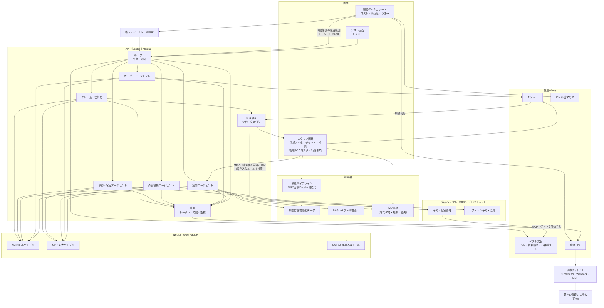
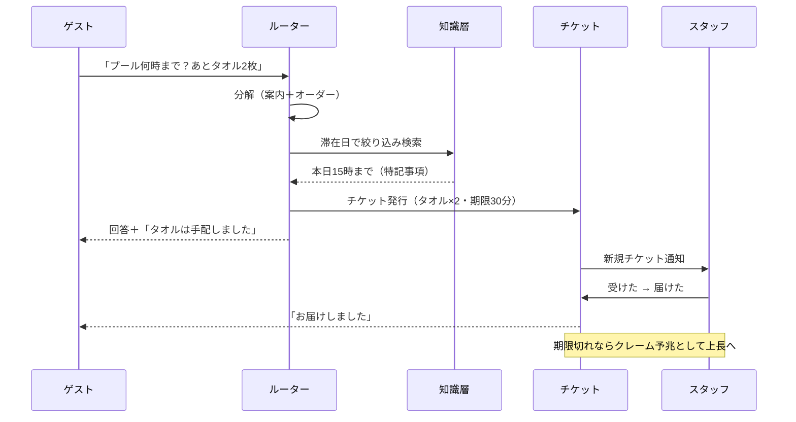

# ホテル運営AIエージェント 企画・構成・開発計画

Nebius x NVIDIA Global AI Hackathon 応募用（締切: 2026-10-30 10:00 PDT ＝ 10-31 02:00 JST）

---

## 0. 現在地と次のアクション（再開用）

**最終更新: 2026-09-26**

### 決定事項
- テーマ: ホテル運営AIエージェント（教育テーマなど過去案は白紙）
- 柱: 期間付き知識 ＋ 特記事項 ＋ オーダーチケット ＋ 経営ダッシュボード
- 応募トラック: Best Apps and Agents
- 人の配置・シフト最適化は作らない。AI側の担当範囲（時間帯別・パターン別のモデル／しきい値）と、変更時のコスト見積もりまで
- 実績は標準形式で出力（CSV／JSON・Webhook・MCP）し、将来の配置エンジンと疎結合にする
- 導入方針: 中は自分たちの仕様が正、入口は既存システムに合わせる（変換層）
- デモ用マスタの数値（時給・対応時間）は本人が入力
- 知識の持ち方: 期間で変わる情報（営業時間・メニュー・実施日）は**マスタ**として登録（PDF・画像からの読み込みは入力補助）。日付で変わらない説明文は**RAGに直接**取り込み、確認なしで運用し、回答精度は定期評価（4.1参照）
- スタッフ画面は2系統: **現場スマホ**（オーダー・AI相談・引き継ぎ）と**管理PC**（マスタ・特記事項の編集・未回答回答・履歴）。特記事項を含む情報の編集はPCからのみ（4.6参照）
- 技術スタック: Next.js＋Mastra（TypeScript統一）＋Supabase＋Nebius Token FactoryのNemotron（6章）。ライセンスはMIT
- ゲストへの回答は、館内情報をサーバーが滞在日で取得して渡し、回答係には調べるツールを持たせない（12章の検証結果による）
- 未回答の質問は、会話ログを定期的に評価して「AIが答えられなかった」質問を見つけ、追記の提案として管理PCに出す（1通ごとのリアルタイム記録はやめる。2026-09-27）。スタッフが代わりに答えていれば回答の下書きにする。期間のある回答は「よくある質問」ではなく資料として登録し、読み取り → 承認の流れに乗せる。デモは定期実行済みの結果をデモデータで再現し、「今すぐ評価する」は置かない。設計は `docs/004_knowledge_gap_review.md`

### 現在地（2026-09-26）
**W1〜W4の計画項目（8章のMVP範囲）はすべて実装済み**。予定より約3週間前倒し。残りはW5（ホスティング・README・英語動画・提出）。

- ブランチ: 作業は `w2/guest-core`（未push・`main` 未マージ）。`main` はW1の初期構築まで。**リモートリポジトリは未作成**（公開・pushは本人の判断待ち）
- DB: Supabaseのクラウドにマイグレーション3本とシードを適用済み。ダッシュボード用のデモ実績（約13,000件、`signals.demo=true`）と、動作確認の試験データ（会話・チケット・引き継ぎ・特記事項など）が入っている
- 開発時の起動: `npm run dev`（Next.js）と `npm run dev:cron`（期限の監視）。当日のデモ出勤は `npm run dev:shifts`
- 使い方・コマンド・コード構成は `CLAUDE.md` にまとめてある（新しいセッションはまずそちらを読む）

実装済みの画面（`/` から各デモへのリンクあり）

| 対象 | パス | 内容 |
|---|---|---|
| ゲスト | `/guest/R-1203`（滞在中）、`/guest/R-1503`（来月） | 滞在日での答え分け、特記事項の優先、オーダーと進捗、スタッフと話す |
| 現場スマホ | `/staff/login` → `/staff/orders`・`/staff/ask`・`/staff/notifications` | 出勤枠の選択、向かう／届けた、対応できない、引き継ぎと返信、AI相談、通知 |
| 管理PC | `/admin`（ホーム）、`/admin/orders`、`/admin/knowledge`、`/admin/items`、`/admin/handoffs` | 今日の要対応、オーダーボード、館内の情報（施設・営業情報とPDF/画像からの下書き、「全体」欄にお知らせと案内・マニュアル）、品目・担当設定、引き継ぎ・クレーム履歴 |
| 経営 | `/manage`、`/manage/policy`、`/manage/integrations`、`/manage/history`、`/manage/masters`、`/manage/members` | 担当範囲とコスト（簡易・精密見積もり）、指示とガードレール（過去の会話で試す）、外部連携（Webhook含む）、変更履歴、マスタ、メンバーと権限 |
| MCP | `/api/mcp/pms`、`/api/mcp/work-events` | 予約・客室管理のモック、実績の出力口（どちらもBearerトークン必須） |

デモ台本（10章）の場面2〜6は、画面で一通り動作確認済み（デモ用の冬季営業のお知らせは `docs/demo/`）。

### 次のアクション
1. **本人の判断が必要**
   - 公開リポジトリの作成とpush（応募の必須要件）
   - デモ用ホテルの設定（ホテル名・施設・季節メニュー）。現在は「デモホテル」と仮の営業時間
   - デモ用マスタの数値（時給・対応時間）を `/manage/masters` で入力（現在はサンプル値表示）
   - プロダクト名
   - 外部の情報源（`/admin/sources`）に登録するURL（候補: JR北海道の運行情報JSON `https://www3.jrhokkaido.co.jp/webunkou/json/area/area_01.json`、tenki.jp の北広島市の天気）。デモ台本に「運休・荒天の情報がスタッフに届き、ゲストの案内が変わる」場面を入れるか
2. **W5の作業**
   - ホスティング先の選定とデプロイ（Vercel等）。本番では `DATABASE_URL` をSession poolerに変える（直接接続はIPv6のみ）、`CRON_SECRET` を設定して `/api/cron/tickets` を1分ごとに呼ぶ、`PMS_MCP_URL` を公開URLに変える
   - デプロイ前の安全面の確認（デモ用ログインはパスワードなしのため、公開環境では入口の保護を検討）
   - README（英語、セットアップ手順、Nemotron／Token Factoryの使いどころ）、英語デモ動画、提出フォーム
3. **品質の改善（余力があれば）**
   - 精密見積もり・「過去の会話で試す」のAI採点が差を出せない／誤判定がある（採点基準の見直し）
   - メニュー同士の期間の重なりの警告が多い（並行提供できるメニューも警告する）
   - 開発サーバーで、ページを開いた直後の数秒は操作が反映されないことがある（本番ビルドで要確認）

### 再開の手順（別セッション向け）
1. `CLAUDE.md` と本書の0章・12章を読む
2. `git switch w2/guest-core`、`npm install`
3. `.env.local` を確認（`NEBIUS_API_KEY`、`SUPABASE_URL`、`SUPABASE_SECRET_KEY`、`DATABASE_URL`、`LLM_MODE`、`PMS_MCP_URL`、`PMS_MCP_TOKEN`、`EXPORT_MCP_TOKEN`。見本は `.env.example`）
4. `npm run dev` → `http://localhost:3000`。`npm run typecheck` / `npm run lint` / `npm run build` で確認

### 審査基準（公式ルールより・配点均等）
| 基準 | 内容 | 本企画での打ち手 |
|---|---|---|
| 技術的な実装 | Token Factory・NVIDIAモデルの使い方 | パターン・時間帯別のNemotron使い分け |
| デザイン | 概念実証ではなく一貫した製品体験か | UIモックから着手、3画面の一貫性 |
| 潜在的な影響 | 実在の課題を実在の相手に解決しているか | ホテル勤務・シフト作成経験、既存ボット満足度23%のデータ |
| アイデアの質 | ありきたりでない使い方、課題の深い理解 | 期間付き知識、特記事項、AIをチームの一員とする見方 |

- 第1段階で「トラックの趣旨に合うか・必須API／SDKを使っているか」の合否判定あり
- 審査員は実際に触らず、説明文・画像・動画だけで判断してよいとされている → **3分動画の画面の分かりやすさが重要**
- Best Apps and Agentsトラックの説明では、重い推論にNemotron 3 Ultra、日常の速い処理にNano／Superを推奨 → 経営ダッシュボードのモデル切り替えと一致
- Nebius Serverless Endpoints／Jobsでのデプロイは推奨（必須ではない）

### 賞の対象
- 全体賞（1位2万ドル・2位1万ドル・3位6千ドル）またはトラック賞（Jetson Orin Nano）のどちらか1つ ＋ 特別賞1つ
- Best Use of Tavily（3,000ドル）: 実行時にTavily APIを呼ぶことが条件
- 都市賞（500ドル）は対面イベント参加者のみ。東京は9/9に開催済みのため対象外

---

## 1. 背景と課題

### 既存ホテルチャットボットの現状
- ゲスト側の満足度は低い（Mythos Group調査: AIチャットボットに満足と答えた宿泊客は23%）
- 簡単な質問には役立つが、複雑な要望は人に頼みたいという声が多い
- ベンダーが出す「解決率」は、有人対応に回らなかった割合であることが多く、実際の満足度とずれている
- 日本のホテル向けは今もFAQ・シナリオ型が中心

### 不満の主な原因
1. **文脈を持っていない**: 予約情報を参照できず、一般論しか返せない
2. **行動できない**: 備品の依頼などをスタッフへのタスクにできない
3. **情報が古い**: 季節で変わる営業時間・メニューを正しく答え分けられない

### 現場経験から見た負担
- **案内（知識）**: 季節によってレストランやアクティビティの営業時間・メニューが変わり、スタッフの研修やキャッチアップが大変
- **オーダー（備品など）**: 毎日の問い合わせ件数で最も多い

---

## 2. コンセプト

**「期間付き知識 ＋ 特記事項 ＋ オーダーチケット」で、ゲスト・スタッフ・経営の3者に価値を出すホテル運営エージェント**

| 対象 | 提供価値 |
|---|---|
| ゲスト | 気軽にAIに聞いて、滞在日に合った正しい答えと素早い対応が得られる |
| スタッフ | 日々変わる情報の共有と、件数の多いオーダー処理の負担を減らす |
| 経営 | AIと人の配置・モデル選択を、コストと満足度の数字で判断できる |

---

## 3. 問い合わせの5パターンと対応方針

| # | パターン | 例 | 対応方式 | AIの権限 |
|---|---|---|---|---|
| 1 | 案内 | 朝食の時間、プールの営業 | 期間付き構造化データ＋RAG | 自動回答（不明時は人へ） |
| 2 | オーダー | タオル2枚、歯ブラシ | 自前のチケット管理 | 自動でチケット発行 |
| 3 | 外部連携 | レストラン予約、混雑案内 | ツール／MCP | ゲストの確認後に確定 |
| 4 | 予約・客室管理 | 部屋の変更 | 予約・客室管理システム連携（MCP） | 候補の提示のみ、確定はスタッフ承認 |
| 5 | クレーム | 隣がうるさい、対応が遅い | 一次受け止め＋要約して人へ | 解決はさせない |

### 横断の仕組み
- **ルーター**: 1通に複数の要望があれば分解する（例: 部屋変更＋備品＋クレームの予兆）
- **ゲスト文脈**: 予約情報（部屋番号・滞在日・プラン）を最初から持つ。取得元はホテルの予約・客室管理システムで、MCPなどの連携口（ゲスト文脈プロバイダ）経由で会話に注入する。項目は「予約」「滞在中の依頼履歴」「ホテルが登録したお客様メモ（記念日など）」を想定し、連携先ごとに変換層で吸収する。デモはモックのMCPサーバーで代替
- **既存システムへの書き戻し**: お客様情報は既存システム側で管理されている前提で、AIからスタッフへの引き継ぎや、次回以降も役立つ情報があれば、MCP経由で既存システム（お客様メモ・依頼履歴）に書き込む。シフト間の引き継ぎ機能を自前では作らず、既存の管理の中に残す
- **読み書きルールの設定**: 連携先ごとに、読み取りルールと書き込みルールを自然文（プロンプト）で設定できる。既存の運用ルール（記載形式、書く項目など）をそのまま書いてもらう想定。ただし「どの項目に書けるか」は下記のガードレールで固定する
- **2→5の自動昇格**: 期限切れのオーダーをクレームの予兆として上長に通知
- **引き継ぎの質**: 会話・予約情報・AIが試したことをまとめて人に渡す（ゲストに二度説明させない）

---

## 4. 機能詳細

### 4.1 期間付き知識（パターン1）
- **2層構成**
  - **マスタ（期間付き構造化データ）**: 施設・内容・有効期間（例: レストランA ランチ 11:30–14:00｜7/1〜8/31）。スタッフが管理PCで登録・編集する。RAGでは夏と冬の情報のどちらが滞在日のものか確実に選べないため、ここは必ずマスタにする
  - **文章の知識（RAG）**: 館内の雰囲気・アクセス・マニュアルなど日付で変わらない説明文。PDFなど複数フォーマットをそのまま取り込み、登録時の確認はしない。回答精度は代理指標とLLM採点で定期評価する
- **回答日付はゲストの滞在日**: 来週泊まるゲストには来週の情報で答える。季節をまたぐ滞在も日ごとに答え分ける
- **更新の入り口**
  - **特記事項はマスタの各施設の中の項目**（期間が短く突発的なもの。例: 屋外プール「本日15時まで点検で閉鎖」）。編集はマスタと同様に管理PCからのみ（現場スマホからは不可）／有効期間中はその施設の通常の営業情報より優先する／保存すると即反映し期限で自動消去。施設に紐づかない情報（「ロビーで18時から物産展」など）はマスタの**「全体」欄**に入れる
  - **画面は「館内の情報」1つ**: 利用者にマスタとRAGの区別を意識させないため、案内・マニュアル（RAG）はマスタ編集画面の「全体」欄の中で登録する（内部の保存先は別のまま）
  - **事前に決めるマスタはない**: 施設（レストラン・大浴場など）も項目（営業時間・メニュー・プラン・予約方法など）も、資料の読み取りで作り、確認画面でスタッフが「新しく作る／既存と同じ」を確かめる。カテゴリ（食事・温浴など）は持たない（LLMの案内の精度にほとんど効かないため。2026-09-28 検証）。導入は既存の資料を入れて確認するだけ（`docs/002_facility_master_design.md`。2026-09-28 実装）
  - **スタッフは「資料」と「特記事項」だけを扱う**: 資料（PDF・画像・文章）を入れる → AIが施設・項目ごとに読み取る（タイトル＋内容＋期間） → スタッフが内容と、承認済みの内容との期間の重なり（どちらを優先するか）を確認して承認 → 承認済みだけを滞在日で絞って回答に使う。資料の原文を毎回LLMに読ませる方式は、期間の違う情報が混ざると誤案内したため採らない（2026-09-28 検証）。特記事項は最優先で、登録時に「〜より優先して案内します」と見せる
- **品質管理**
  - 期間の重なりなど矛盾を自動で指摘
  - 長期間更新されていない項目に「要確認」
  - ゲストの未回答質問をスタッフ側に一覧化 → 回答が知識として蓄積。未回答の質問は会話ログの定期評価で見つけ（AIが「確認します」と答えた、推測で答えた、ゲストが聞き直した、スタッフが代わりに答えた、など）、同じ意味の質問をまとめて追記を提案する（`docs/004_knowledge_gap_review.md`）
- **スタッフ向け相談相手**: 新人が同じ知識ベースに質問できる（研修・キャッチアップの負担軽減）

### 4.2 オーダーチケット（パターン2）
- ゲストの要望を定型チケット化（品目・数量・部屋番号・期限）
- **自動アサイン**（早い者勝ちにはしない。時給制でスタッフに受けるインセンティブがなく、受けない方が楽になるため）
  - **枠 = 役割 × エリア**。品目ごとに担当役割をマスタで決め（タオル・アメニティ→ハウスキーピング、飲み物→ルームサービスなど）、部屋番号から担当エリア（フロア）を決める。その日の枠と担当者はスマホで出勤時に選ぶ（将来は既存のシフトシステムから連携）
  - **重みづけ**: 品目ごとに負荷を3段階でマスタ設定（軽=1pt: タオル・アメニティ／中=2pt: 枕・寝具／重=3pt: 加湿器・ベビーベッドなど設置を伴うもの）。1件の重み＝含まれる品目の最大段階
  - **均等化**: 同じ枠に複数の担当者がいる場合、「本日の累計pt＋未完了pt」が最も少ない人に割り当てる。同点なら最後の割り当てから時間が空いている人。同じフロアの近い時間の依頼は同じ人にまとめる（動線短縮）
  - 割り当ては**機械ロジック**で行う（公平性の説明がしやすく、結果が再現できるため）。LLMはゲストの文章から品目・数量を読み取る部分に使う
  - 実績の対応時間から重みの妥当性を検証し、段階の見直しに使う（4.4の想定値→実測値補正と同じ仕組み）
- スタッフは「向かう」「届けた」の2タップ。「対応できない」で枠内の次の人へ再割り当て（理由を記録）
- 割り当てから一定時間（設定可）着手されなければ、枠内の次の人へ再割り当て、さらに上長へ通知
- スマホに本日の担当量（pt）と枠内平均を表示し、偏りがないことを本人も確認できる。管理PCでは担当者別のボードと、上長による付け替え
- ゲストに進捗を自動通知（追いの問い合わせを減らす）
- 期限切れはクレーム予兆として昇格

### 4.3 経営ダッシュボード
- **1件あたりの解決コスト**: AI（推論・検索・インフラ）と人（時給×対応時間）を同じ単位で比較
- **隠れコストの可視化**: 安いモデルで人への引き継ぎが増え、総額が上がるケース
- **満足度の代理指標**: 引き継ぎ率、聞き直し率、「人と話したい」率、オーダー期限内対応率、感情スコア推移、👍👎
- **調整つまみ（AIの担当範囲）**: AIは人数ではなく「どの業務をどこまで任せるか」で配置する
  1. パターン別の担当（AIが受けるか、人に直接回すか）
  2. パターン別のモデル割り当て（小型／大型）
  3. 人への引き継ぎしきい値（確信度）
  4. 上記を**時間帯別**に設定（例: 深夜は引き継ぎ先が手薄なので大型モデルでAI完結率を上げる、昼は小型モデルで安く済ませ迷ったら人へ）
- **設定変更時のコスト見積もり（2段階）**
  1. **簡易見積もり（即時）**: 過去実績のパターン別・時間帯別の件数と入出力トークン数 × 新しいモデル単価。変更前後の月額差分を表示
  2. **精密見積もり（任意実行）**: 過去ログのサンプルを新しいモデルで再生し、実際のトークン数・AI採点による品質・引き継ぎ率の変化を計測。引き継ぎ増による人の対応コスト（マスタの時給×対応時間）も含めた総額で比較
- **自動化しない領域の固定**: クレームは常に大型モデル＋人
- **人の配置は対象外**: 人のシフト・人数の最適化は作らない。マスタの時給と対応時間から「人が対応した場合の概算」を比較表示するのみ

### 4.7 AIの指示・ガードレール・外部連携の設定（経営／管理者向け）
経営ダッシュボードに「担当範囲とコスト」「指示とガードレール」「外部連携」「変更履歴」のタブを設ける。

- **指示（プロンプト、自然文で編集）**
  - 共通の指示（言葉づかい、答え方）
  - 業務（5パターン）ごとの指示（例: クレームは補償に触れずに事実確認→引き継ぎ）
  - 外部連携ごとの読み取りルール・書き込みルール（既存の運用ルールをそのまま記述）
- **ガードレール（固定の制限、指示より優先、応答の前後で自動チェック）**
  - してはいけないこと（値引き・補償の約束、他のお客様の情報、体調への助言など）
  - 必ず人に引き継ぐ条件（「スタッフと話したい」、強い不満、2回答えられない、安全に関わる内容）
  - 確定前に必ずお客様へ確認する操作（レストラン予約、有料サービス、部屋変更の候補）
  - 外部連携の項目ごとの読み書き権限（例: 予約内容は読み取りのみ、お客様メモ・依頼履歴は追記のみ、料金・支払いは読み取りも不可）
  - クレーム関連の書き込みはスタッフ確認後、書き込み形式が合わなければ保留
- **考え方**: 「何を・どう書くか」は柔軟に自然文で、「どこに書けるか・何をしてはいけないか」は構造化した設定で固定する。プロンプトの書き方次第で権限を越えられないようにするため
- **変更の安全策**: 保存前に「過去の会話で試す」で指示の変更を過去ログに当てて結果を確認できる（精密見積もりと同じ再生の仕組みを使う）。変更履歴を残し、元に戻せる
- **ハッカソンの範囲**: 共通・業務別の指示、ガードレールの一部（禁止事項・引き継ぎ条件・項目別の読み書き権限）、予約・客室管理システム（モックMCP）への追記を実装。変更履歴と過去ログでの試行は余力があれば

### 4.8 権限（機能ごとの権限をメンバーに付与、グループで設定負荷を下げる）
役割で固定せず、**機能ごとの権限**をメンバーごとに付けられるようにする。AWS IAMのように、権限をまとめた**グループ**（プリセット）を用意し、通常はグループに所属させるだけで済むようにする。

- **メンバーの種類**: スタッフ（人）だけでなく、**AIエージェント**と**MCPで接続する外部システム**も同じ「メンバー」として扱う。AIも権限を持つチームの一員として管理でき（11章の考え方と一致）、将来他のシステムからMCPで操作させる場合も同じ仕組みで制御できる
- **権限の単位**: 画面ではなく操作ごと。MCPのツール1つ＝権限1つに対応させる
  - オーダー: 登録する／担当になれる（自動アサインの対象）／ボードを見る／付け替える
  - 情報: 施設・営業情報を編集／特記事項を編集／館内案内・マニュアルを登録／未回答の質問に回答
  - 対応: 引き継ぎに対応／クレーム履歴を見る
  - 設定: 品目・担当設定／AIの担当範囲とコスト／指示とガードレール／外部連携／人件費などのマスタ／メンバーと権限の管理
- **範囲の指定（任意）**: 権限に範囲を付けられる（例: 特記事項の編集をレストランのみ、担当になれるのをハウスキーピング12〜15Fの枠のみ）
- **期限付きの付与**: 一時的な応援に対応する（例: オーダー担当が足りない日に、フロントの山本さんへ「担当になれる」を本日21時まで付与）。期限が来たら自動で外れる
- **実効権限（合計の考え方）**: 所属グループの権限と個別に付けた権限の**合計**。どれか1つでも許可していれば許可
  - 権限は操作ごとに独立しており、「〜のみ」という排他的な権限は持たない。例: グループで「担当になれる」、個人で「オーダーを登録する」なら両方できる
  - 同じ権限で範囲が異なる場合は広い方が有効（例: グループ「特記事項の編集：レストランのみ」＋個人「全施設」→ 全施設）
  - 期限付きの個別付与が切れると、グループの権限のみに戻る
  - グループの権限を個人単位で弱めることはできない。その場合は別のグループを作るか、必要な権限だけを個別に付ける
  - 明示的な「拒否」は今回は設けない。必要になった場合は、拒否がどの許可よりも優先するルールとして後から追加できる
  - 両立させたくない組み合わせ（例: 登録者を担当にしない）は権限ではなく業務ルールとして自動アサイン側で扱う。現時点で該当するものはないため設けない
- **プリセットのグループ（初期値、編集可）**
  | グループ | 主な権限 |
  |---|---|
  | 現場スタッフ | オーダーの担当になれる、AIに相談、引き継ぎに対応 |
  | フロント | オーダー登録、ボード閲覧、未回答の質問に回答、引き継ぎに対応、クレーム履歴を見る |
  | 上長 | フロントの権限＋付け替え、施設・営業情報と特記事項の編集、館内案内の登録、品目・担当設定 |
  | 管理者 | すべての設定、メンバーと権限の管理 |
  | AIエージェント | オーダー登録、引き継ぎの作成、予約・客室管理システムの読み取りと追記（4.7のガードレールの範囲内） |
  | 外部連携（読み取り） | 実績・オーダー状況の読み取りのみ |
- **監査ログ**: 誰（人・AI・外部システム）が、どの権限で、何をしたかを記録する。実績の出力口（4.5）と同じ形式で出力可能
- **ハッカソンの範囲**: 権限の一覧、プリセットのグループ、メンバーへのグループ付与と期限付きの個別付与、AIエージェントの権限チェック（MCPツール呼び出し時）を実装。範囲の指定と監査ログの画面は余力があれば

### 4.5 実績の出力口
配置の判断（人を含めたチーム全体の最適化）は将来、外部または別システムで行えるよう、実績を標準形式で出力する。
- **実績イベントの項目**: 業務の種類（5パターン）、時間帯、担当（AIのモデル名／人の役職）、入出力トークン数、所要時間、コスト、結果（解決・引き継ぎ・クレーム化）、満足度の代理指標
- **出し方**: CSV／JSONエクスポート、Webhook、MCPサーバー（既存の管理システムや別のAIエージェントが直接問い合わせ可能）

### 4.6 スタッフ画面の分類
※ 下表は画面の置き場所と、プリセットのグループでの標準的な割り当て。実際の操作可否は4.8の権限設定で決まる

| 機能 | 現場スマホ | 管理PC |
|---|---|---|
| オーダーチケット（自動アサイン、向かう／届けた、対応できない） | ○ | 担当者別ボード・付け替え・品目の重みと役割のマスタ |
| 期限超過・クレーム予兆の通知 | ○（担当者） | ○（上長・履歴と経緯） |
| ゲストの「スタッフと話したい」の引き継ぎ（AI要約付き） | ○（引き受ける） | 履歴のみ |
| 特記事項の登録・編集・期限の管理（マスタ編集画面の各施設・「全体」欄の中） | ― | ○ |
| AIに相談（新人の質問） | ○ | ― |
| 施設・営業情報のマスタ編集（PDF・画像からの下書き入力） | ― | ○ |
| 期間の重なり・長期間未更新の警告 | ― | ○ |
| 館内案内・マニュアル（RAG文書）の登録（館内の情報の「全体」欄） | ― | ○ |
| 未回答の質問への回答 → 知識として蓄積 | ― | ○ |

- 現場スマホは下部タブ（オーダー／AIに相談／通知）。情報の登録・編集機能は持たせないで、片手・大きなボタン（高さ52px前後）を前提にする
- 管理PCはホーム「今日の要対応」（未回答の質問、引き継ぎ・クレーム予兆、情報の点検）を起点にする

### 4.4 ホテル別マスタ設定
- 人件費: 役職別時給、時間帯別割増
- 対応時間: パターン別の平均（オーダーは「受付」「配達」を分ける）
- AI単価: モデル別の入力／出力トークン単価、インフラ月額（見積もりに使用）
- 目標値: 満足度下限、引き継ぎ率上限（将来の自動最適化の制約）
- **想定値 → 実測値で補正**: チケットの時刻から実対応時間を計算し、想定との差を表示

---

## 5. システム構成図

### 問い合わせ処理の流れ

---

## 6. 技術スタック（案）

| 領域 | 採用候補 | 備考 |
|---|---|---|
| 言語 | TypeScriptで統一 | 画面とエージェントで型を共有 |
| フロント | Next.js（App Router） | ゲスト・現場スマホ・管理PC・経営の画面 |
| API・エージェント | Mastra（Next.jsに組み込み） | 回答係エージェント（`answer` ツールの強制呼び出しで回答と未回答を分けて受け取る）、MCPクライアント（予約・客室管理）、MCPサーバー（モックPMS・実績の出力口）、保存先（`mastra` スキーマ）。ルーター・抽出・採点はAI SDKの強制ツール呼び出し（`src/lib/llm/structured.ts`）。Mastraの全HTTP APIは公開しない。Hono・FastAPIは使わない |
| 業務ロジック | 素のTS（DBは `pg` で直接SQL） | オーダー割り当て・期限切れ昇格はLLMを使わない。期限監視は `/api/cron/tickets` を1分ごとに呼ぶ |
| DB・ベクトル | Supabase（Postgres＋pgvector） | 構造化データとRAGを同居 |
| 推論 | Nebius Token Factory（OpenAI互換、`https://api.tokenfactory.nebius.com/v1/`） | 小型＝Nemotron 3.5 Lightning（ルーター・品名抽出）、中型＝3 Super（案内・オーダーの回答の既定、禁止事項の後チェック、採点）、大型＝3 Ultra（クレーム一次対応）。単価と実測は12章 |
| PDF・画像の読み取り | Token Factory上の画像対応モデル（GLM-5.3-Flash、MiniCPM-Vなど） | Token FactoryにNemotronの画像対応モデルはない（2026-09-25時点）。文字のPDFはテキスト抽出してNemotronに渡す |
| 埋め込み | Qwen/Qwen3-Embedding-8B（Token Factory、$0.01/1M） | NVIDIA製の埋め込みは提供なし。ローカルと本番でインデックスを混ぜない |
| 外部連携 | MCPサーバー（自作モック、`/api/mcp/pms`） | 予約・客室管理（読み取り・お客様メモ／依頼履歴への追記）。レストラン予約のモックは未作成 |
| ローカル確認 | AI SDKのテスト用モックモデル | LLM費用なしでUI・業務ロジックを確認。品質評価はToken Factoryで行う |
| ホスティング | 要検討（W5） | 提出にホスト済みデモが必要 |
| オプション | Tavily | 周辺の最新情報検索。特別賞あり |

---

## 7. 応募要件チェック

- [x] NVIDIAのオープンモデルを最低1つ使用（Nemotron 3.5 Lightning／3 Super／3 Ultra）
- [x] Nebius Token Factory または Nebius AI Cloud で実行時の推論（開発環境で実施。ホスト済みデモでも同じ）
- [ ] 公開リポジトリ（オープンソースライセンス付き）← MITライセンスは追加済み、リポジトリ作成とpushは本人判断待ち
- [ ] セットアップ手順
- [ ] ホスト済みデモまたはテストビルド
- [ ] 英語のデモ動画（3分以内、YouTubeで公開、著作権のある音楽などを使わない）
- [ ] READMEでNemotron／Token Factory／その他Nebiusツールの使いどころを明記
- [ ] Nebius Token Factory・NVIDIAツールへのフィードバック記入（提出フォーム）
- [ ] プロジェクト説明
- [ ] カテゴリ選択（候補: Best Apps and Agents）

※ 最終確認は公式ルール（Devpost）で行う

---

## 8. スコープ

### MVPで作る
- パターン1（期間付き知識・特記事項・PDF取込）
- パターン2（オーダーチケット・スタッフ画面）
- パターン5（一次対応＋引き継ぎ、2→5昇格）
- ルーター（分類・分解）
- 経営ダッシュボード（コスト・代理指標・時間帯別のAI担当範囲・変更時の見積もり・マスタ）
- AIの指示とガードレールの設定、外部連携の読み書きルール（予約・客室管理システムのモックMCPへの読み取りと追記）
- 実績の出力口（CSV／JSON、MCPサーバー）

### モックで最小限
- パターン3・4（MCPモックを1つ動かす程度）

### 設計図のみ（将来）
- 自動最適化（満足度下限を守りつつコスト最小化）
- 人のシフト・人数の最適化
- 実システムとの連携
- 多言語・音声

---

## 9. 開発計画（5週間）

※ 2026-09-26時点でW1〜W4は完了（前倒し）。各週の実装内容はgitの履歴と0章の表を参照

| 週 | 期間 | 目標 | 主な作業 |
|---|---|---|---|
| W1 | 9/25–10/1 | 基盤と知識層 | リポジトリ・ライセンス作成、Token Factory接続確認（モデル・単価調査）、DBスキーマ（期間付きデータ・特記事項・チケット・ログ・マスタ）、デモ用ホテルのデータ作成 |
| W2 | 10/2–10/8 | ゲスト対応の中核 | ルーター、案内エージェント（滞在日での絞り込み＋RAG）、オーダーチケット、ゲストチャット画面 |
| W3 | 10/9–10/15 | スタッフ側 | 現場スマホ（自動アサイン・チケット2タップ・AI相談・引き継ぎ）、管理PC（マスタ・特記事項の編集とPDFからの下書き入力・未回答回答・要対応ホーム）、矛盾検知、引き継ぎと2→5昇格 |
| W4 | 10/16–10/22 | 経営側 | 計測（トークン・時間）、1件あたりコスト、代理指標、時間帯別のAI担当範囲設定、変更時の見積もり（簡易→精密）、マスタ画面、実績の出力口（CSV／MCP）、指示・ガードレール設定画面、予約・客室管理のモックMCP（読み取り＋追記） |
| W5 | 10/23–10/30 | 仕上げと提出 | デモシナリオ調整、ホスティング、README・セットアップ手順、英語動画の撮影・編集、提出（余裕を持って10/29中に） |

### 週ごとの判断ポイント
- **W1末**: Token FactoryのNemotronでツール呼び出し・構造化出力を確定。Mastra経由で動かなければOpenAI互換プロバイダー（baseURL指定）に、モデル側が苦手ならルーターの構造化出力＋自前のツール実行に切り替える
- **W3末**: 動く部分でデモを一度通し撮り。足りない部分を洗い出す
- **W4末**: 機能凍結。以降は品質と動画に集中

---

## 10. デモシナリオ（3分・英語）

1. **課題提示（20秒）**: 既存ボットの満足度は低い。原因は文脈不足・行動不可・情報の古さ
2. **季節の切り替え（40秒）**: 管理PCで冬季営業のPDFを読み込む → マスタに下書きが入る → 修正して保存 → 今日のゲストと来月のゲストが同じ質問をし、違う正しい答えが返る
3. **特記事項（20秒）**: 管理PCで屋外プールに特記事項「本日15時まで閉鎖」を登録 → ゲストの質問に即反映
4. **オーダー（30秒）**: 「タオル2枚と歯ブラシ」→ 枠内で担当量が最も少ないスタッフに自動アサイン → 2タップで完了 → ゲストに通知
5. **クレーム昇格（20秒）**: 期限切れチケットが上長に要約付きで通知
6. **経営ダッシュボード（40秒）**: 深夜帯の案内を大型モデルに切り替える設定変更 → 過去実績から月額差分を即時見積もり → 精密見積もりで引き継ぎ減による人の対応コスト削減も含めた総額を表示。逆に安いモデルで引き継ぎが増え総額が上がるケースも示す
7. **まとめ（10秒）**: ゲスト・スタッフ・経営の3者に価値

---

## 11. 将来構想

### AIをチームの一員として扱う
- 人もAIも同じ「メンバー」として定義する（できる業務、権限、コスト＝固定費＋従量費、稼働枠、実績）
- 小型モデル＝安く簡単な案内が得意な新人、大型モデル＝難しい案件もこなすベテラン、人への引き継ぎ＝先輩への相談
- 配置エンジンは「メンバー台帳・業務の定義・実績ログ」だけを見て割り当てを決め、相手がAIか人かを知らない（疎結合）
- 今回の実績の出力口は、この配置エンジンにつなぐための契約として設計する

### 導入方針
- **中は自分たちの仕様が正**: メンバー・業務・実績の内部モデルは崩さない
- **入口は既存に合わせる**: シフト表・勤怠・予約・客室管理システムのデータは変換層（アダプター）で取り込む
- **指標は既存の言葉に翻訳**: 人件費率や口コミ評価など、経営層が普段見ている指標の隣に並べる

---

## 12. 未決事項

- [x] 技術スタック → Next.js＋Mastra（TS統一）。Strands・Python案は不採用（2026-09-25）
- [x] Token FactoryのNemotronの実呼び出し確認（2026-09-25）
  - 単価（/1M、APIの`/v1/models`より）: Lightning・Nano 入$0.06/出$0.24、Super 入$0.30/出$0.90、Ultra 入$1/出$3
  - ツール呼び出し: 4モデルとも動作。`tool_choice`で関数を指定した強制呼び出しも動作
  - 構造化出力: `json_schema`はエラーにならないが、モデル一覧で`structured_outputs`非対応の表示。スキーマは保証されないため、構造化出力は強制ツール呼び出し＋Zod検証＋再試行で行う
  - `usage`: 4モデルとも入出力トークン数を返す（Nanoのみ推論トークンの内訳なし）
  - 推論（thinking）は`chat_template_kwargs: {enable_thinking: false}`で無効化でき、速度とトークンが大きく改善（例: Nano 11.9秒→1.9秒）。ルーター・抽出は無効、クレーム・難問は有効を基本にする
  - 応答時間（thinking無効、短文）: Lightning 0.5〜0.8秒、Super・Ultra 約1〜1.3秒、Nano 1〜2秒
- [x] Mastra経由で`chat_template_kwargs`と強制ツール呼び出しを渡せるか → 可（`scripts/verify-llm.ts`で確認、2026-09-25）
- [x] ゲストへの回答の方式（2026-09-25〜26の検証）
  - 回答係にツールで調べさせると、Lightningがツール呼び出しを文字で書く・同じ呼び出しを216回繰り返すことがあった → 館内情報はサーバーが滞在日で取得し、文章にして渡す
  - 館内情報をシステム指示に置くと、マスタ更新後も会話中の古い回答を繰り返した → 最後のゲストの発言の前に【最新の館内情報】として付ける
  - 小型（Lightning）はデータのない項目（朝食時間）を推測で答えた → 案内・オーダーの回答は中型（Super）を既定に
  - 情報にないことを「ございません」と断定した → 指示で禁止し、答えられない質問は未回答として記録（管理PCで回答すると知識に蓄積）
  - LLMに品目マスタとの照合までさせると誤る（別名にある品をないと判断、ない品を当てはめる） → LLMは品名と数量の読み取りだけ、照合はコード
- [x] ガードレールの実装: 応答前の引き継ぎ条件（`guardrails.code`、オン・オフ可）と、応答後の禁止事項チェック（中型で判定。小型は値引きの約束などを見逃した）
- [x] 埋め込みは Qwen3-Embedding-8B を1536次元で取得（pgvectorのHNSW上限が2000次元のため）
- [x] PDF・画像の読み取り: PDFは文字抽出（NFKCで正規化）、画像は GLM-5.3-Flash で書き起こし（推論オフでも `</think>` までの思考を出すので捨てる）→ Superで期間付きの表に構造化
- [x] 館内の情報の持ち方（2026-09-28）→ スタッフは資料と特記事項だけを扱う。資料はAIが読み取り、スタッフが確認・承認したものだけを回答に使う（原文を毎回読ませる方式は、期間の違う情報が混ざると誤案内したため不採用）。値の型は1つ（タイトル＋本文＋期間）。期間の重なりは承認時にスタッフが優先を選ぶ（特記事項は常に最優先）。施設・項目も資料から作り、カテゴリは持たない。詳細は `docs/002_facility_master_design.md`
- [x] 施設・項目を資料から作る変更とカテゴリの削除の実装（2026-09-28）
- [ ] 未回答の質問を会話ログの定期評価に置き換える（`docs/004_knowledge_gap_review.md`。2026-09-27 決定）
- [ ] 適用期間の末尾をLLMに計算させない（「9/30まで」を9/28に「本日が最終日」と誤答。滞在期間に合わせてサーバーで言い換える。`docs/002_facility_master_design.md` 6章）
- [ ] WebサイトのURLを資料として登録し、定期取得する（更新時に読み直して承認を依頼。`docs/002_facility_master_design.md` 6章）→ 提出後
- [ ] ホスティング先
- [ ] 公開リポジトリの作成とpush
- [ ] デモ用マスタの数値（時給・パターン別対応時間）→ 本人が入力
- [ ] デモ用ホテルの設定（架空ホテル、季節メニュー、施設）
- [x] Tavily連携を入れるか → 入れる（2026-09-27）。当初はゲストの質問ごとにWeb検索したが、周辺の店探しはゲスト自身がChatGPTなどで調べる方が質が高く、価値が薄いため廃止。代わりに**管理者が登録したURLだけを定期取得**（Tavily Extract、検索はしない）し、運行情報・天気・イベントをAIが要約してゲストの案内・AI相談に使い、影響が大きいときはスタッフに通知する。情報源の信頼性は登録者の責務（登録時に確認のチェック）。取得頻度は基本設定に加え、台風の接近などで期間を限定して上げられる。公式ルール上、実行時に機能として呼んでいれば定期取得でも対象
- [ ] プロダクト名

---

## 参考
- [Nebius x NVIDIA Global AI Hackathon（Devpost）](https://nebiusglobalaihackathon.devpost.com/)
- [Conduit: AI Chatbot for Hotels](https://conduit.ai/blog/ai-chatbot-for-hotels)
- [Hotel Dive: Using tech to close the guest experience gap](https://www.hoteldive.com/spons/using-tech-to-close-the-guest-experience-gap/750531/)
