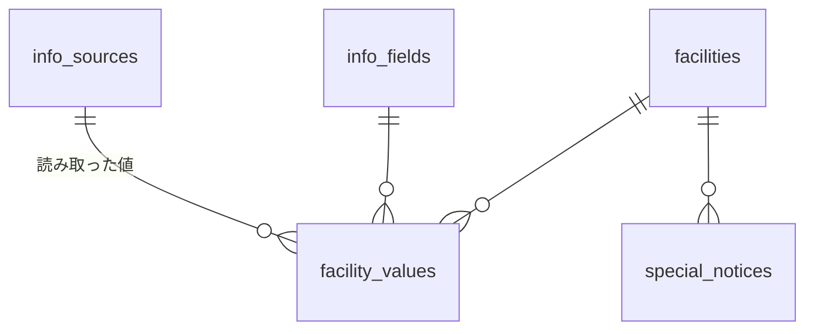

# 館内の情報（資料・施設・項目）

状態:

- **実装済み**（2026-09-28。マイグレーション `20260928000000_facility_fields.sql`、`20260930000000_info_sources.sql`）: 資料の読み取り → 確認 → 承認、値の型なし（タイトル＋本文＋期間）、期間の重なりの優先を承認時に選ぶ、特記事項の「〜より優先して案内」の表示。施設・カテゴリ・項目は導入時にDBで設定
- **次に実装する変更**（2026-09-28 決定、未実装）: **カテゴリを削除し、施設と項目も資料の読み取りで作る**。事前に決めるマスタをなくす

この文書は、次に実装する変更を反映した仕様。現在の実装との違いは各章の「現在の実装」と7章に書く。

## 0. 方針と決定事項

- **スタッフは「資料」と「特記事項」だけを扱う**。営業時間やメニューを1件ずつ入力する画面はない。既存の資料（営業案内・お知らせのPDF・画像、文章）を入れると、AIが施設・項目ごとに読み取り、スタッフが内容を確認して承認する。回答に使うのは承認済みの内容だけ
- **事前に決めるマスタはない**。施設も項目も、資料の読み取りで作り、確認画面でスタッフが確かめる。導入は「既存の資料を入れて確認する」だけ。ホテルと「全体」欄だけはシステムが持つ
- **どこに入れるとAIがうまく答えるかをスタッフに判断させない**。「RAG」「マスタ」の区別は画面に出さない。回答の精度の調整は開発側の仕事で、スタッフの接点は「未回答の質問」に答えることだけ
- **資料は毎回参照せず、読み取って承認したものを使う**。資料の原文をそのままLLMに渡す方式（RAGで毎回参照）と比べた実験（2026-09-28、Super）で、原文方式は期間の違う情報が混ざると滞在日に合わない内容を答えた（「秋の特別ディナーの子ども料金は？」に提供期間外なのに「6,000円です」、「冬の鍋会席は食べられる？」に「はい」と答えてから矛盾）。読み取り方式は滞在日で絞ってから渡すため誤案内はなく、期間外は「スタッフに確認」になった（安全側）
- **値の型は1つ**: タイトル（任意）＋本文（自由文）＋適用期間（終了日なし可）。料金が大人・子どもと何種類あっても本文に書ける。回答の時点で時刻や料金をコードで計算していないため、型で構造化しても精度は上がらない。期間とタイトルだけが構造として効く
- **優先順**: 特記事項が最優先（自動）。それ以外で期間が重なるもの（資料どうし）は、**承認時にスタッフがどちらを優先するか選ぶ**
- **カテゴリは持たない**。LLMの案内の精度にほとんど効かないため（下記の検証）
- 変えていないこと: 知識の2層（期間で変わる情報は読み取った値、変わらない長い説明文はRAG）、回答は滞在日基準、特記事項の期限による自動消去、「全体」欄（特記事項と案内・マニュアル（RAG）の置き場）

用語: 注文の「品目」（`order_items`）と区別するため、施設の属性は「**項目**」と呼ぶ。

### カテゴリを削除する根拠（2026-09-28、Super）

- ルーターに施設名だけを渡すと、「お風呂は何時まで？」→ `大浴場 せせらぎ` は選べた。「食事ができるところは？」「夕飯はどこで？」「リラックスできる施設は？」「子どもと遊べるところは？」は何も選ばなかった
- 何も選ばないときは全施設の情報を回答係に渡す作りのため、「食事ができるところは？」→ レストランの時間を案内し、ほかは「記載がないためスタッフに」、「夕飯はどこで？」→ レストランのディナーと秋の特別ディナーを案内できた
- カテゴリの効果は「食事」などで渡す情報を絞れることと、管理PCのサイドメニューを見出しでまとめることだけ。小規模なホテルでは全施設を渡しても数十行で、精度への影響は小さい

### 項目を資料から作ることで弱くなる点

- 以前は、カテゴリに「営業時間」があるのに値がなければ「朝食会場 営業時間: 情報なし」とAIに明示していた。項目を資料から作ると、どの資料にも書かれていない項目はその施設に存在しないため「情報なし」と渡せない
- 今までどおり「情報なし」を渡せるのは、施設に内容が1件もないときと、項目はあるが滞在期間にかかる値がないとき（冬季の朝食時間が書かれていない、など）
- 書かれていないことは、回答係への指示「館内の情報に書かれていないことは推測せず、スタッフに確認すると伝える」で受ける。回答は中型（Super）が既定。実装後に実モデルで確かめる

## 1. データ構造

| テーブル | 主な列 | 役割 |
|---|---|---|
| `facilities` | `name`、`sort`、`kind`（`global` は「全体」欄で1件） | 施設。資料の承認で作る。資料を消しても残す（特記事項や権限の範囲が付くため） |
| `info_fields` | `name`、`sort` | 項目名の一覧（ホテル全体で1つ。施設をまたいで同じ名前を使い回す）。資料の承認で作る |
| `info_sources` | `title`、`file_name`、`body`（読み取った本文）、`status`（`pending`／`approved`）、読み取り結果（確認待ちの施設・項目の候補） | 資料。元ファイルは保存しない |
| `facility_values` | `facility_id`、`field_id`、`source_id`、`title`、`body`、`valid daterange`、`priority`、`status`（`pending`／`approved`） | 施設 × 項目 × 期間の値 |

- 施設が持つ項目 ＝ その施設の承認済みの値に出てくる項目（並び順は `info_fields.sort`）
- 期間は `daterange`。終了日なしは上限なし（`[2026-04-01,)`）。アプリでは `parseValidRange` で `to: null` として扱う
- 資料を消すと、読み取った値も消える（`on delete cascade`）。施設と項目名は残る
- `facility_period_overlaps` は、承認済みで同じ施設・項目・タイトル、期間が重なり、**優先度が同じ**（どちらを優先するか決まっていない）組。管理PCの「要確認」に使う
- **削除するもの**: `facility_categories`、`category_fields`、`facilities.category_id`

現在の実装: `facility_categories`・`category_fields` があり、施設はカテゴリに属し、カテゴリで使う項目が決まっている。施設・項目は導入時にSQLで登録する。

## 2. 画面（管理PC「館内の情報」）

- **サイドメニュー**: 「資料」（確認待ちの件数）→「全体」→ 施設（`sort` 順。カテゴリの見出しはなくなる）。`/admin/knowledge` は資料のページへ移動する
- **資料**（`/admin/knowledge/sources`）: 資料の名前、ファイル（PDF・画像・テキスト）または文章を入れて「読み取る」→ 確認画面へ。一覧は確認待ちを上に出し、削除できる
- **確認画面**（`/admin/knowledge/sources/[id]`）:
  - **新しい施設**: 資料に出てくる施設のうち、登録済みの施設と名前が一致しないもの。スタッフは「新しい施設として登録（名前は正式名称に直せる）」か「既存の○○と同じ」を選ぶ。「風見」と「レストラン」のように同じか判断がつかないものも、AIの推測で決めずにここで選ぶ
  - **新しい項目**: 読み取った項目名のうち、既存の項目名にないもの。「新しい項目」の印を付け、既存の項目に合わせるか、そのまま新しい項目にするかを選ぶ（「営業時間」と「営業時間帯」の重複を防ぐ）
  - 読み取った内容の表（施設・項目・タイトル・内容・適用期間・終了日なし）。直す、行を消す、行を足す。項目は既存の名前から選ぶか、新しい名前を入れる
  - **期間が重なっている内容**: 同じ施設・項目・タイトルで、承認済みの値や同じ資料の他の行と期間が重なる組を並べ、どちらで案内するかを選ぶ。すべて選ぶまで承認できない。重なる期間は選んだ方だけで案内し、それ以外の期間はどちらもそのまま使う
  - 資料の本文（読み取りの元）
  - 承認済みの資料も開き直して、直して承認し直せる（その資料の値を置き換える）
- **施設の画面**: 項目ごとに、案内している内容（承認済み）を期間・出どころ付きで表示する（編集は資料の確認画面で行う）。優先される値に譲っている期間は除いて表示し、「重なる期間は ○○ を優先」と添える。その下に特記事項
- **特記事項**: 追加の欄で期間を入れると、「この期間は、営業時間「ランチ」、営業時間「ディナー」より優先して案内します」と、期間の重なる他の特記事項（両方案内する）を登録前に見せる。登録済みの特記事項にも「〜より優先して案内」を表示する
- **「全体」の画面**: 特記事項と案内・マニュアル（RAG。未回答の質問への回答と、施設に紐づかない長いマニュアル）
- 不要になった施設を隠す・消す操作は別に用意する（資料の削除では消えない）

現在の実装: 確認画面は既存の施設・項目から選ぶだけで、どの項目にも入らない内容は「どの項目にも入らなかった内容」として見せている。サイドメニューはカテゴリの見出しでまとめている。

## 3. サーバーの処理

### 資料の読み取り（`src/server/info-sources.ts`）

1. **施設の洗い出し**: 資料に出てくる施設をAIに列挙させ、登録済みの施設と照合する（`matchName`: 完全一致 → 空白・全角半角を無視 → 1件に絞れる部分一致）。一致しないものは新しい施設の候補にする
2. **施設ごとの読み取り**: 施設ごとに Super で1回ずつ並行して読み取る。項目名は、承認済みの項目名の一覧を渡して「同じものを指すときは同じ名前にする」と指示し、ないときは資料に合わせて新しく付けさせる
   - 資料全体から全施設を一度に読み取らせると、資料の主な施設に引っ張られてほかの施設の記述（「大浴場は6:00〜24:00」）を落とした
3. **根拠の確認**: 先に「その施設について書かれた文」（`quotes`）を抜き出させ、内容に出てくる時刻・金額の数字がその中にない件は捨てる（`grounded`）。施設ごとに読ませると、レストランのディナーの時間を大浴場のものとして入れることがあった（「大浴場は通常どおり営業」しか書かれていない資料で3回中3回）
4. 項目名は選択肢（enum）にせず文字列で受け、照合はコードで行う（選択肢にすると、短く書かれたときに検証で弾かれ、再試行で内容ごと落とすことがある）
5. タイトルの表記ゆれ対策: その施設・項目の承認済みのタイトルを渡し、同じものを指すときは同じタイトルにさせる（重なりの判定がタイトル単位のため）
6. 期間: 年がなければ今日以降で最も近い年。開始日が書かれていない通常の案内は今日から、終了日がなければ終了日なし。「12/31のみ」は1日
7. 挨拶・署名など案内に使わない文は入れない。「通常どおり営業」のように時間も休みも書かれていない記述は取り出さない

現在の実装: 施設の洗い出しは、登録済みの施設の名前（またはその一部）が資料に出てくるかをコードで見るだけ。項目はその施設のカテゴリの項目から選ばせ、当てはまらないものは `unplaced` に入れている。

### 承認（`approveSource`）

- 新しい施設・新しい項目の選択（新しく作る／既存と同じ）を反映して、施設と項目名を作る
- 確認画面から送られた行を検証し、重なりを `findConflicts` で出し直して、すべて選ばれているかを確かめる
- **優先度**: 承認済みの値の優先度は変えず、新しい値をその間に入れる（`assignPriorities`）。負けた側から順に、置ける範囲のできるだけ下に置く。選び方が矛盾していれば（A＞B、B＞C、C＞A）エラー
- その資料の値を消して入れ直し、資料を承認済みにする
- 権限: 既存の施設の値を置き換えるときは、その施設の `knowledge.facility.edit`（範囲付き）。新しい施設を作るときは範囲なしの `knowledge.facility.edit`

### 回答への渡し方（`src/server/knowledge.ts`、`answer-context.ts`）

- `getFacilityInfo`: 承認済みの値をすべて取り、`effectivePeriods` で「同じタイトルでより優先される値に覆われた期間」を除いてから、滞在期間にかかるものだけを渡す。例: 通常「ランチ 11:30〜」（4/1〜、終了日なし）と冬季「ランチ 休業」（10/15〜3/31、優先）→ 通常は 4/1〜10/14 と 4/1〜 の2つに分かれ、11/10の滞在では冬季だけが渡る
- 施設名で引く（カテゴリ名では引かない）。ルーターが何も選ばないときは全施設の情報を渡す。指定された施設で内容が1件もなければ「情報なし」、項目はあるが滞在期間の値がなければ項目ごとに「情報なし」と渡す
- 文章: `■施設名` → 特記事項（最優先）→ 項目順に `営業時間「ランチ」: 11:30〜14:00（適用期間 2026-04-01〜2026-10-14）`
- ルーター（`router.ts`）の選択肢は施設名だけにする

### 共通の関数（`src/server/facility-fields.ts`）

DBに依存しない関数（確認画面のブラウザ側でも使う）: `parseValidRange`、`overlaps`、`periodText`、`titleKey`、`describeValue`、`effectivePeriods`、`findConflicts`、`assignPriorities`

## 4. 導入と移行

- 導入時: ホテルと「全体」欄だけを作る。施設・項目は、既存の資料を入れて確認・承認すると作られる
- デモ（`supabase/seed.sql`）: 施設・項目・値は、デモの資料を承認した状態として入れる（資料の行を作り、`source_id` を付ける）。冬季の内容は、デモの場面2で `docs/demo/winter-notice.pdf` を資料として読み取るため入れない
- 既存の環境の移行（次のマイグレーション）: `facilities.category_id`、`category_fields`、`facility_categories` を削除する。`source_id` のない値（導入時の設定）は、「導入時の設定」という資料を1件作って紐づける（施設の画面の出どころ表示と、資料の削除で消せるようにするため）
- クラウドのデモ環境のレストランには、以前の確認で保存された冬季の値が「導入時の設定」として入っている。デモの場面2の前に消す

## 5. 確認済みのこと（2026-09-28、Token Factory）

現在の実装で確認したこと:

- 冬季営業のお知らせPDF: レストランのランチ休業・ディナー・冬の鍋会席・年越しそば御膳（12/31のみ）、屋外プールの休業を読み取り、大浴場の「通常どおり営業」は取り出さなかった（2回とも同じ）
- 複数施設の案内文: レストランのランチ・ディナーと大浴場の営業時間を読み取った
- 承認済みの値と重なる4件を確認画面に出し、「この資料を優先」で承認すると、11/10の滞在では冬季の内容だけ、10/13〜16の滞在では通常と冬季が期間を分けて渡った
- 来月滞在のゲストの「レストランのランチとディナーの時間は？」に、冬季の内容で答えた

未確認: 確認画面での操作（重なりの選択・承認のボタン）をブラウザで通すこと、特記事項の登録前の表示、ローカルの `db:reset`。

## 6. 未実装・残タスク

- **WebサイトのURLを資料として登録し、定期取得する**（提出後）: 外部の情報源（`external-sources.ts`、Tavily Extract）の仕組みで定期取得し、内容が変わったら読み直して「サイトが更新されました。確認してください」と承認を依頼する
- **期間の末尾をLLMに計算させない**: 屋外プール（9/30まで営業）を、9/28〜30に滞在するゲストに「本日が最終日」と答えた。適用期間をそのまま渡すと、LLMが日付の計算を誤る。滞在期間に合わせて「ご滞在中は毎日」「10/1から休業」のようにサーバーで言い換えて渡す
- **資料の差し替えの差分表示**: 新しい版を入れたときに、前の版から読み取った値との差分（変わった・消えた・増えた）を見せる。今は古い資料を削除して新しい資料を入れ、重なりを確認する運用
- **読み取りの評価セット**: 施設・項目の読み取りと取り違えを継続的に確認する
- 資料の元ファイルの保存（Supabase Storage）。今は読み取った本文だけを持つ
- 期間外の近い情報を「滞在期間外」として渡し、「10/15から提供です」と案内できるようにする
- 施設を隠す・消す操作、施設の別名（旧名・通称）とルーターでの照合

## 7. 次の実装の作業

1. マイグレーション: カテゴリ関連を削除、導入時の値に「導入時の設定」の資料を紐づける、`info_sources` に読み取り結果（新しい施設・項目の候補）を持たせる
2. 読み取り: 施設の洗い出し（AI＋コードの照合）、項目名を資料から付ける、`unplaced` をなくす
3. 確認画面: 新しい施設・新しい項目の選択、項目の入力を「既存から選ぶ／新しい名前」にする
4. 承認: 施設と項目名の作成、権限の確認
5. 回答: ルーターと `getFacilityInfo` からカテゴリを外す、「情報なし」の出し方を1章のとおりにする
6. 画面: サイドメニューからカテゴリの見出しを外す
7. シードとクラウドのデモ環境: 資料を承認した状態で入れ直す、冬季の値を消す
8. 実モデルで確認: 資料からの施設・項目の作成、書かれていない項目を聞かれたときに推測しないこと、デモの場面2・3
9. CLAUDE.md・`001_db_schema.md` を実装に合わせて更新
