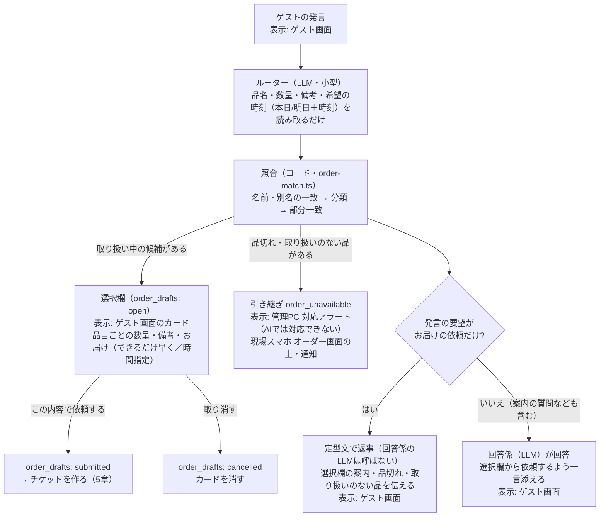
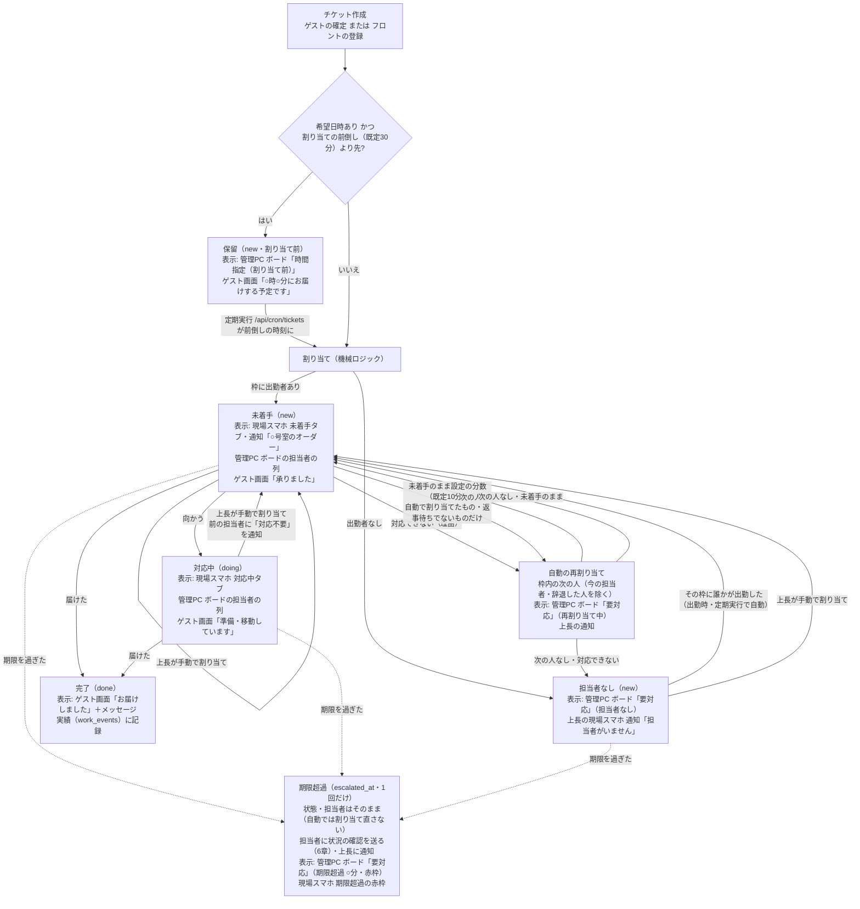
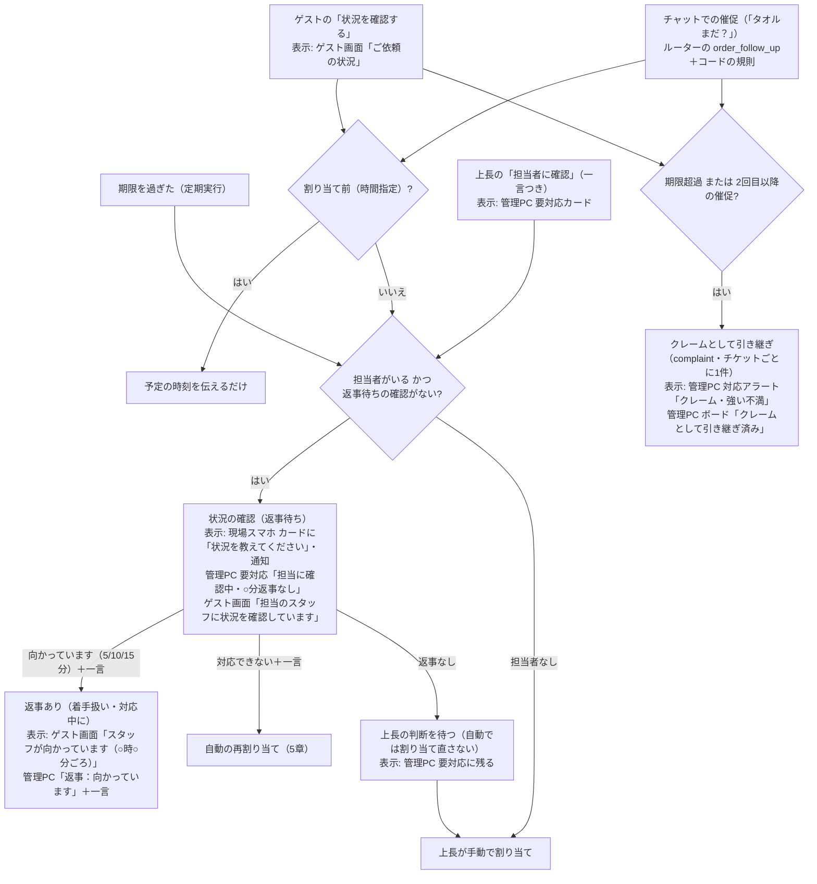

# オーダーの仕様（2026-09-27 時点の実装）

plan 4.2 のオーダーチケットの、今の実装の仕様。改修の経緯（品目の分類、選択欄、担当席、部屋のID、時間指定、品切れ）もここにまとめる。

## 0. 画面の呼び方

| 呼び方 | パス | 使う人 |
|---|---|---|
| ゲスト画面 | `/guest/[予約番号]` | ゲスト |
| 現場スマホ | `/staff/*`（オーダー `/staff/orders`、通知 `/staff/notifications`、引き継ぎ `/staff/handoffs/[id]`） | 現場スタッフ・担当席 |
| 管理PC | `/admin/*`（オーダーボード `/admin/orders`、品目・担当設定 `/admin/items`、対応アラート `/admin/handoffs`） | フロント・上長 |
| 経営 | `/manage/*`（メンバーと権限 `/manage/members` など） | 経営・管理者 |

## 1. 品目

- 品目はゲストが選べる単位（フェイスタオル、バスタオル…）で持ち、**分類**（タオル、アメニティ…）を付ける。分類は選択欄のまとまりと、ゲストの言い方の照合に使う
- 品目ごとに、担当の役割、重み（軽1pt／中2pt／重3pt）、期限（分）、取り扱いの状態を持つ。別名は任意（照合の補助）
- 設定は管理PC `/admin/items`。館内の情報の資料フロー（読み取り→承認）には乗せない（重み・担当を持つ運用の設定で、期間で変わる案内情報とは性質が違うため）

### 取り扱いの状態（在庫数は持たない）

| 状態 | ゲスト画面・AI | フロント（管理PC） |
|---|---|---|
| 取り扱い中 | 選べる | 選べる |
| 一時品切れ | 選択欄に「品切れ中」で出し、選べない。はっきり頼まれた品が品切れなら「ただいま品切れ」と伝え、引き継ぎ `order_unavailable` を作る | 「品切れ中」で出し、選べない |
| 取り扱い終了 | 存在しない扱い。頼まれたら取り扱いのない品として引き継ぎ `order_unavailable` を作る | 出さない |

既存システムの在庫と連動する場合は、予約・客室管理システムのMCPに在庫を読むツールを足し、状態に変換する（将来。設計のみ）。

## 2. 担当（枠・担当席）

- **枠 = 役割 × エリア**。品目の役割と、部屋のエリアで枠が決まる（エリアの枠を優先し、なければ全館担当の枠）。役割の違う品目は、枠ごとに別のチケットになる
- 担当は個人のアカウントのほか、**担当席**（枠ごとの共有アカウント。例: 「ハウスキーピング 別館 ①」）でもよい。管理PC `/admin/items` で枠の人数を決めると席が作られる（`members.seat_slot_id`）。席はその枠だけの「担当になれる」と、AIに相談・引き継ぎに対応の権限を持つ。人数を減らすと番号の大きい席から無効にする（未完了のオーダーがある席は減らせない）
- 担当の候補は、その枠に**今日出勤している**、「担当になれる」権限を持つ人。出勤・退勤は現場スマホで行う
- 自動の割り当て（機械ロジック、`orders.ts`）: 同じ棟・フロアで10分以内に割り当てた未着手のチケットを持つ人（まとめ）→ 本日の担当量（累計pt＋未完了pt）が最小 → 最後の割り当てが古い順
- 役割×エリアの2段は残す（役割＝品目のまとまり、エリア＝部屋のまとまり。枠に品目・部屋を直接結ぶと、品目を足すたびに全枠を直すことになる）

## 3. 部屋

- 部屋は予約・客室管理システムの客室ID（`rooms.id`）で持つ。表示は棟＋部屋番号（例: 「別館 105」、本館は番号のみ）。チケットの `room_number` 列には表示名を入れる
- エリアは部屋ごと（`rooms.area_id`）。管理PC `/admin/items` の「エリアと部屋」で棟・フロアごとにまとめて割り当てる

## 4. 受付

### ゲスト（AIチャット）

- ①と②は別々に決まる。例: 「ヘアアイロンとタオルを」→ 選択欄（タオル）と引き継ぎ（ヘアアイロン）の両方を作り、返事は定型文。「プールは何時まで？あと枕」→ 選択欄を作り、返事は回答係
- 安全に関わる内容・「スタッフと話したい」・クレームの引き継ぎは、この前後にガードレールで判定する（`guest-chat.ts`）。「スタッフと話したい」のときは選択欄を作ったうえで人に引き継ぎ、AIは回答しない

- 「タオル」のように分類で頼まれたら、その分類の品をすべて数量0で並べる（ゲストが選ぶ）。品目が1つに決まるときだけ数量を入れる。当たった品と同じ分類の品も数量0で並べる
- 備考はルーターが下書きし、ゲストが直せる。希望の時刻は本日／明日＋時刻だけを読み取らせ、日付はサーバーで決める（過ぎた時刻なら指定なし）
- LLMに照合までさせると誤った（別名にある品をないと判断、ない品を既存品目に当てはめる。2026-09-25）。候補を広めに出して最後はゲストが選ぶので、照合の誤りはゲストが直せる

### フロント（電話・来訪）

- 管理PC `/admin/orders` の「オーダーを登録」。部屋（表示名で入力→客室IDに当てる）・受付の種類・分類ごとの品目と数量・備考・お届け（できるだけ早く／本日・明日の時刻指定）を選ぶ
- 部屋と品目を選ぶと、枠ごとの割り当て予定がその場で出る（実際と同じ選び方。時間指定なら「お届けの○分前に割り当て」）
- 自由文の読み取りは廃止した

## 5. チケットの状態遷移

`tickets.status` は `new`（未着手）／`doing`（対応中）／`done`（完了）／`cancelled`。割り当て前の保留は `dispatched_at` が空の `new`、担当者なしは `assignee_id` が空の `new`。割り当てはできるだけ自動で行い、上長の手動割り当ては例外（クレームに発展しそうなときなど）に使う。

- 期限: 希望日時があればその時刻、なければ作成時刻＋品目の期限（分）の最小
- 期限を過ぎても自動では割り当て直さない。担当者が部屋に向かっている途中かもしれず、別の人とぶつかるため。まず担当者に状況を確認し（6章）、返事がなければ上長の判断を待つ
- 未着手のまま時間が過ぎたときの自動の再割り当ては、ほかに担当できる人がいなければ今の担当者のまま残す。割り当て直したら、前の担当者に「対応不要」を通知する
- 手動割り当て（管理PC、権限「手動で割り当てる」`order.reassign`）: 要対応のカードから。候補は表示中の枠の人を先に、ほかの枠に今日出勤している人も並べる。ほかの枠の人を選ぶとチケットをその枠に移す（担当量とボードの表示を担当者の枠にそろえる）。移す元と移す先の両方の枠の権限を確認する。割り当て時刻を今にし、未着手に戻し、状況の確認をリセットする。対応中の人がいるときは画面で注意を出し、前の担当者に「対応不要」を通知する
- 手動で割り当てたチケット（`assignment_mode = 'manual'`）は、未着手のままでも自動の再割り当てにかけない（上長の判断を優先）
- 上長が手動で割り当てたチケットは「要対応」から外れ、担当者の列に出る（期限超過・返事待ち・クレームなら要対応に残る）
- `cancelled` は状態として持つが、取り消す操作はまだない

## 6. 状況の確認と催促

期限切れ・ゲストの催促・上長の依頼で、今の担当者に「状況の確認」を送る（`order-checks.ts`）。担当者は定型の返事と任意の一言で答える。オーダー遅延の引き継ぎ（`overdue_order`）は作らない（種類は過去の記録のために残す）。

- 担当者の一言は上長だけに見え、ゲストには出さない。ゲストに見せるのは定型の返事（向かっています・○時○分ごろ）だけ
- ゲストの「状況を確認する」は、ゲスト画面のヘッダーの「ご依頼の状況 N件」から、未完了のご依頼ごとに押せる。同じご依頼は3分間は押せない（返事待ちの間も押せない）
- チャットでの催促: ルーターに会話の未完了のご依頼を渡し、催促か新しい依頼かを判定させる（`order_follow_up`）。モデルの判定がぶれるため、コードで固める（`router.ts`）
  - 催促とみなすのは、催促の言葉（まだ／いつ／遅い／来ない／届かない／どうなって／状況 など）があり、モデルが催促と判定したか、読み取った品が未完了のご依頼と同じ（同じ分類）とき
  - 催促なら、未完了のご依頼と同じ品の読み取りを落とし（選択欄を出さない）、ボタンの「状況を確認する」と同じ処理をする（期限超過・2回目以降ならクレーム）。強い言葉がなければクレームの要望も落とす
  - 例: 「タオルまだ？」→ 催促／「タオルもう1枚追加で」→ 新しい依頼／「タオルまだ？あと枕も」→ 催促＋枕の選択欄
  - ゲストの発言に出てこない品は、どの場合も依頼にしない（未完了のご依頼を渡すと、発言にない品を order に入れることがあった）
- 催促ではない不満（ルーターが complaint と判定）は、これまでどおりクレームとして引き継ぎ（`guest-chat.ts`）、あわせて会話の未完了のチケットを催促として数えて担当者に確認を送る
- 「向かっています」は着手とみなし、未着手なら対応中にする。「対応できない」は着手済みでも枠内の次の人に回せる

### お届け時間の変更

- ゲストは「ご依頼の状況」の「時間を変更」（本日／明日＋時刻）か、チャット（「8:30〜40に届けてもらえる？」）で、未完了のご依頼のお届け時間を変えられる（`order-checks.ts` の `rescheduleTicket`）
- 未着手なら希望日時と期限を変える（範囲は始まりの時刻にし、「お届け希望 8:30〜08:40」を備考に足す）。変更後の時刻が割り当ての前倒しより先なら割り当てを外して保留に戻し、今の担当者には「対応不要」を通知する。もうすぐなら担当者はそのままで「お届け時間の変更」を通知する
- 対応中（向かっている途中）は自動で変えず、担当者に状況の確認として希望を伝える
- 過ぎた時刻・滞在期間外は受け付けない。返事は定型文（回答係のLLMは呼ばない）
- チャットの読み取り（`router.ts`）: ルーターの `order_reschedule`。時刻が「数字＋:／時」の形で発言にあり、「追加・もう1枚・もっと」などの追加の依頼の言葉がないときだけ時間の変更とする（「20分以内」を 0:20 と読んだり、「1枚追加で、10時に」を時間変更にしたりした）。範囲の終わりは発言からコードで読む
- 「以内・急いで・早く」は催促として扱う（新しい依頼にしない）

### 回答係はお届けを約束しない

- 回答係に「お届けの時刻・時間の変更・到着の見込み・手配の完了を自分から約束しない。お届けの状況は【ご依頼の状況】に書かれたことだけを伝える」と指示し、未完了のご依頼の状況（予定の時刻・確認中・向かっているなど）を渡す（`describeOpenTickets`）。AIが「8:30〜40の間にお届けいたします」と答えたのに、チケットは変わっていなかったため（2026-09-28）

## 7. 設定（管理PC `/admin/items`）

| 設定 | 既定 |
|---|---|
| 未着手のまま次の人へ回すまで | 10分 |
| 時間指定のオーダーを割り当てるタイミング | お届けの30分前 |
| 同じフロアの近い時間の依頼はまとめる | オン |
| 「対応できない」は理由の入力を必須にする | オン |
| 担当の枠（役割×エリア）と担当席の人数、エリアと部屋 | — |

## 8. 既知の課題（未対応）

- 期限超過の通知と状況の確認は1回だけ（ゲストの催促や上長の「担当者に確認」で再び確認はできる）
- 担当者から上長への自由なメッセージ（確認への返事以外）はない
- チケットを取り消す操作がない（ゲスト・フロントとも）
- チャットでの時間の変更は、未完了のご依頼すべてに当てる（ご依頼が複数あるとき、どれかだけを変えるのは「ご依頼の状況」から）
- 過去の `overdue_order` の引き継ぎは、現場スマホの引き継ぎ一覧に残る（新しくは作らない）

## 9. スコープ外

- 電話などゲストとの会話中に、LLMでフロントの入力を補助すること
- 在庫数の管理、既存の在庫システムとの連動
