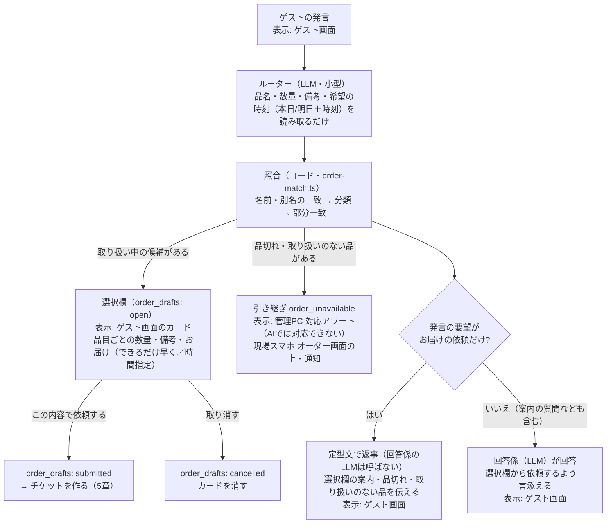
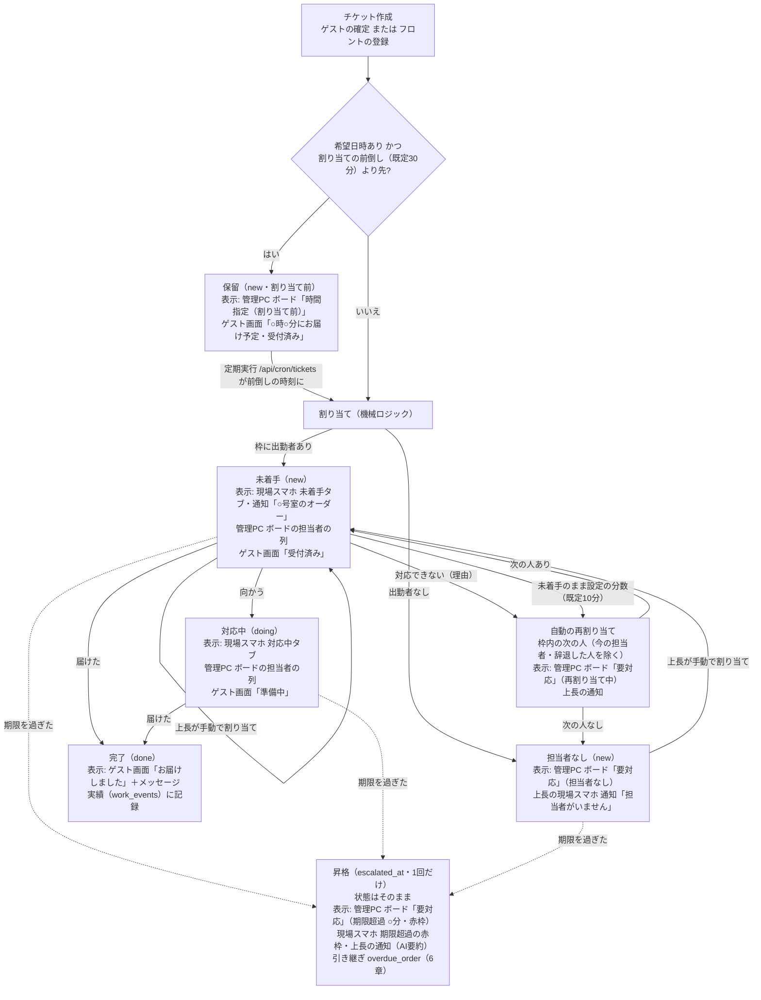

# オーダーの仕様（2026-09-27 時点の実装）

plan 4.2 のオーダーチケットの、今の実装の仕様。改修の経緯（品目の分類、選択欄、担当席、部屋のID、時間指定、品切れ）もここにまとめる。

## 0. 画面の呼び方

| 呼び方 | パス | 使う人 |
|---|---|---|
| ゲスト画面 | `/guest/[予約番号]` | ゲスト |
| 現場スマホ | `/staff/*`（オーダー `/staff/orders`、通知 `/staff/notifications`、引き継ぎ `/staff/handoffs/[id]`） | 現場スタッフ・担当席 |
| 管理PC | `/admin/*`（オーダーボード `/admin/orders`、品目・担当設定 `/admin/items`、対応アラート `/admin/handoffs`） | フロント・上長 |
| 経営 | `/manage/*`（メンバーと権限 `/manage/members` など） | 経営・管理者 |

## 1. 品目

- 品目はゲストが選べる単位（フェイスタオル、バスタオル…）で持ち、**分類**（タオル、アメニティ…）を付ける。分類は選択欄のまとまりと、ゲストの言い方の照合に使う
- 品目ごとに、担当の役割、重み（軽1pt／中2pt／重3pt）、期限（分）、取り扱いの状態を持つ。別名は任意（照合の補助）
- 設定は管理PC `/admin/items`。館内の情報の資料フロー（読み取り→承認）には乗せない（重み・担当を持つ運用の設定で、期間で変わる案内情報とは性質が違うため）

### 取り扱いの状態（在庫数は持たない）

| 状態 | ゲスト画面・AI | フロント（管理PC） |
|---|---|---|
| 取り扱い中 | 選べる | 選べる |
| 一時品切れ | 選択欄に「品切れ中」で出し、選べない。はっきり頼まれた品が品切れなら「ただいま品切れ」と伝え、引き継ぎ `order_unavailable` を作る | 「品切れ中」で出し、選べない |
| 取り扱い終了 | 存在しない扱い。頼まれたら取り扱いのない品として引き継ぎ `order_unavailable` を作る | 出さない |

既存システムの在庫と連動する場合は、予約・客室管理システムのMCPに在庫を読むツールを足し、状態に変換する（将来。設計のみ）。

## 2. 担当（枠・担当席）

- **枠 = 役割 × エリア**。品目の役割と、部屋のエリアで枠が決まる（エリアの枠を優先し、なければ全館担当の枠）。役割の違う品目は、枠ごとに別のチケットになる
- 担当は個人のアカウントのほか、**担当席**（枠ごとの共有アカウント。例: 「ハウスキーピング 別館 ①」）でもよい。管理PC `/admin/items` で枠の人数を決めると席が作られる（`members.seat_slot_id`）。席はその枠だけの「担当になれる」と、AIに相談・引き継ぎに対応の権限を持つ。人数を減らすと番号の大きい席から無効にする（未完了のオーダーがある席は減らせない）
- 担当の候補は、その枠に**今日出勤している**、「担当になれる」権限を持つ人。出勤・退勤は現場スマホで行う
- 自動の割り当て（機械ロジック、`orders.ts`）: 同じ棟・フロアで10分以内に割り当てた未着手のチケットを持つ人（まとめ）→ 本日の担当量（累計pt＋未完了pt）が最小 → 最後の割り当てが古い順
- 役割×エリアの2段は残す（役割＝品目のまとまり、エリア＝部屋のまとまり。枠に品目・部屋を直接結ぶと、品目を足すたびに全枠を直すことになる）

## 3. 部屋

- 部屋は予約・客室管理システムの客室ID（`rooms.id`）で持つ。表示は棟＋部屋番号（例: 「別館 105」、本館は番号のみ）。チケットの `room_number` 列には表示名を入れる
- エリアは部屋ごと（`rooms.area_id`）。管理PC `/admin/items` の「エリアと部屋」で棟・フロアごとにまとめて割り当てる

## 4. 受付

### ゲスト（AIチャット）

- ①と②は別々に決まる。例: 「ヘアアイロンとタオルを」→ 選択欄（タオル）と引き継ぎ（ヘアアイロン）の両方を作り、返事は定型文。「プールは何時まで？あと枕」→ 選択欄を作り、返事は回答係
- 安全に関わる内容・「スタッフと話したい」・クレームの引き継ぎは、この前後にガードレールで判定する（`guest-chat.ts`）。「スタッフと話したい」のときは選択欄を作ったうえで人に引き継ぎ、AIは回答しない

- 「タオル」のように分類で頼まれたら、その分類の品をすべて数量0で並べる（ゲストが選ぶ）。品目が1つに決まるときだけ数量を入れる。当たった品と同じ分類の品も数量0で並べる
- 備考はルーターが下書きし、ゲストが直せる。希望の時刻は本日／明日＋時刻だけを読み取らせ、日付はサーバーで決める（過ぎた時刻なら指定なし）
- LLMに照合までさせると誤った（別名にある品をないと判断、ない品を既存品目に当てはめる。2026-09-25）。候補を広めに出して最後はゲストが選ぶので、照合の誤りはゲストが直せる

### フロント（電話・来訪）

- 管理PC `/admin/orders` の「オーダーを登録」。部屋（表示名で入力→客室IDに当てる）・受付の種類・分類ごとの品目と数量・備考・お届け（できるだけ早く／本日・明日の時刻指定）を選ぶ
- 部屋と品目を選ぶと、枠ごとの割り当て予定がその場で出る（実際と同じ選び方。時間指定なら「お届けの○分前に割り当て」）
- 自由文の読み取りは廃止した

## 5. チケットの状態遷移

`tickets.status` は `new`（未着手）／`doing`（対応中）／`done`（完了）／`cancelled`。割り当て前の保留は `dispatched_at` が空の `new`、担当者なしは `assignee_id` が空の `new`。

- 期限: 希望日時があればその時刻、なければ作成時刻＋品目の期限（分）の最小
- 手動割り当て（管理PC、権限「手動で割り当てる」`order.reassign`）: 要対応のカードから。候補は表示中の枠の人を先に、ほかの枠に今日出勤している人も並べる。ほかの枠の人を選ぶとチケットをその枠に移す（担当量とボードの表示を担当者の枠にそろえる）。移す元と移す先の両方の枠の権限を確認する。割り当て時刻を今にし、未着手に戻す
- 上長が手動で割り当てたチケットは「要対応」から外れ、担当者の列に出る（期限超過なら要対応に残る）
- `cancelled` は状態として持つが、取り消す操作はまだない

## 6. オーダー遅延の引き継ぎ（`overdue_order`）

期限を過ぎたとき（5章の昇格）、チケットと別に引き継ぎを作る。

| 場所 | 表示 |
|---|---|
| 管理PC 対応アラート `/admin/handoffs` | 出ない（分類に含めない。`src/lib/handoff-kinds.ts`） |
| 管理PC オーダーボード `/admin/orders` | チケットとして「要対応」に「期限超過」で出る。引き継ぎとAIの要約は出ない |
| 現場スマホ `/staff/orders` | 「引き継ぎに対応」の権限を持つ全員（現場スタッフ・担当席を含む）のオーダー画面の上に赤字で出て、「対応する」ボタンがある。通知も届く |
| 予約・客室管理システム | お客様メモへの書き戻しは、スタッフの確認待ちで保存する |

## 7. 設定（管理PC `/admin/items`）

| 設定 | 既定 |
|---|---|
| 未着手のまま次の人へ回すまで | 10分 |
| 時間指定のオーダーを割り当てるタイミング | お届けの30分前 |
| 同じフロアの近い時間の依頼はまとめる | オン |
| 「対応できない」は理由の入力を必須にする | オン |
| 担当の枠（役割×エリア）と担当席の人数、エリアと部屋 | — |

## 8. 既知の課題（未対応）

- あとからその枠に出勤しても、担当者なしのチケットは自動で割り当てられない（上長の手動割り当てが必要）
- 1人しかいない枠で未着手が続くと、再割り当ての候補がいないため担当者なしになる
- 上長が手動で割り当てた相手も、未着手のまま設定の分数が過ぎると自動の再割り当てにかかる
- 期限超過の昇格は1回だけ。手動で割り当て直した後に再び遅れても、もう一度は知らせない
- オーダー遅延の引き継ぎは、届けた後も自動で閉じない。管理PCに閉じる場所がなく、現場スマホに残り続ける。通知が現場スタッフ・担当席にも届く
- チケットを取り消す操作がない（ゲスト・フロントとも）

## 9. スコープ外

- 電話などゲストとの会話中に、LLMでフロントの入力を補助すること
- 在庫数の管理、既存の在庫システムとの連動
